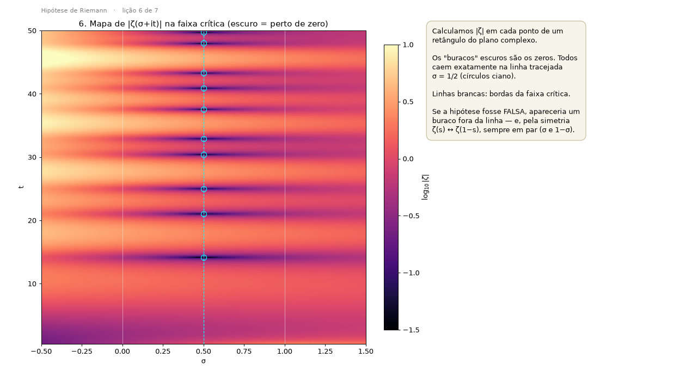
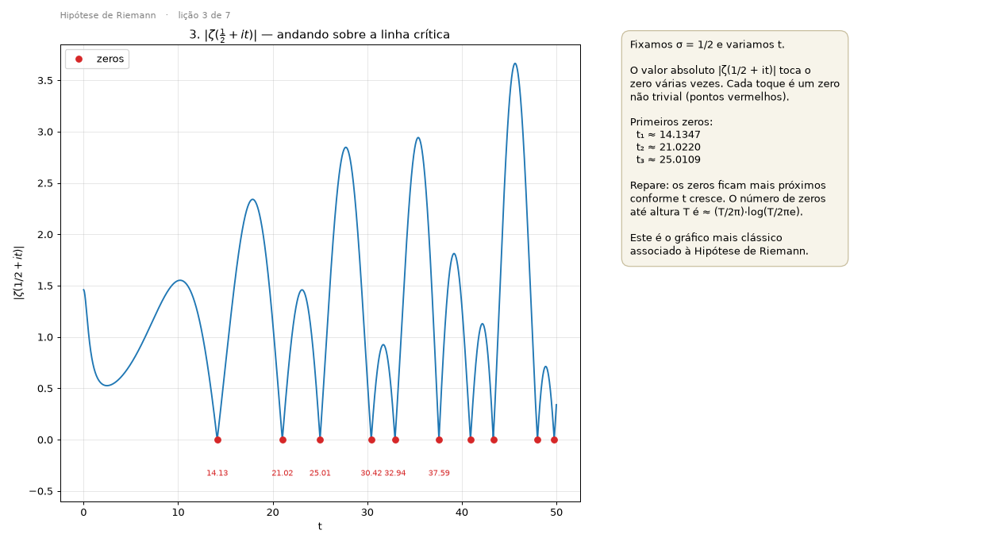
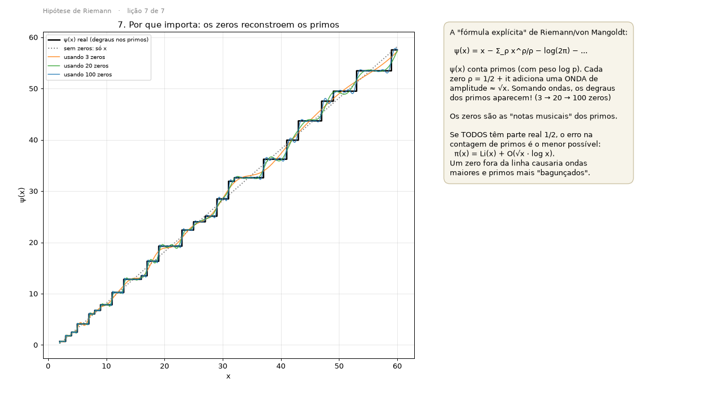

# Hipótese de Riemann: um passeio visual

Material didático em Python para **entender a Hipótese de Riemann com gráficos**. Ele começa pela função
zeta e vai até a verificação de zeros em alturas de 10⁸, com um laboratório que compara **CPU × GPU**.



## O que tem aqui

| Arquivo | O que é |
|---|---|
| [`riemann_hipotese.ipynb`](riemann_hipotese.ipynb) | **Notebook Jupyter** com 9 lições, fórmulas e células para experimentar. Já vem com os gráficos, então dá para ler direto no GitHub. |
| [`riemann_app.py`](riemann_app.py) | **Aplicativo com janela** (matplotlib) com as lições 1 a 7 e botões ◀ ▶ para navegar. |

## As lições

1. **O que é ζ(s):** a soma 1 + 1/2ˢ + 1/3ˢ + …, ζ(2) = π²/6 e a ligação de Euler com os primos.
2. **O mapa dos zeros:** a faixa crítica, a linha crítica σ = ½ e o enunciado da hipótese.
3. **|ζ(½ + it)|:** o gráfico clássico, que toca o zero em t ≈ 14,13; 21,02; 25,01…
4. **Função Z de Hardy:** cada troca de sinal é um zero sobre a linha crítica.
5. **A espiral:** ζ no plano complexo passa pela origem só quando σ = ½.
6. **Mapa de calor:** |ζ(σ+it)| na faixa crítica.
7. **Por que importa:** os zeros reconstroem a "escada" dos números primos (fórmula explícita).
8. **🧪 Laboratório (só no notebook):** conta zeros perto de t = 10⁸ com a fórmula de Riemann–Siegel, compara CPU × GPU e mostra por que `float32` não serve.
9. **🏎️ Limites da GPU (só no notebook):** um kernel CUDA próprio (`cp.RawKernel`), uma varredura de alturas com vazão em termos/s, a busca do "muro" da precisão do `float64`, `float32` × `float64` e testes de memória. Os resultados são salvos em `benchmark_gpu.csv`.

| | |
|---|---|
|  |  |

## Como rodar

Requer Python 3.10 ou mais novo.

```bash
pip install -r requirements.txt
```

**Notebook:**

```bash
pip install notebook
jupyter notebook riemann_hipotese.ipynb
```

No Jupyter, use **Run → Run All Cells**. Depois mude as variáveis marcadas com 🔧 e rode a célula de novo.

**Aplicativo com janela:**

```bash
python riemann_app.py
```

Navegue com os botões ou com as setas ← → do teclado. Para salvar as imagens das lições, use
`python riemann_app.py --salvar pasta`.

### GPU (opcional)

As lições 8 e 9 usam automaticamente uma GPU NVIDIA se o [CuPy](https://cupy.dev) estiver instalado. Rode
`nvidia-smi` e escolha o pacote pela **CUDA Version** do driver (instale só um deles):

```bash
pip install "cupy-cuda13x[ctk]"   # driver com CUDA 13.x
pip install "cupy-cuda12x[ctk]"   # driver com CUDA 12.x
```

Se o seu usuário do Windows tem acento (ex.: `C:\Users\Usuário`), o notebook contorna sozinho uma limitação do
compilador de kernels da NVIDIA, que não aceita esses caminhos.

Sem CuPy, tudo roda na CPU. O mesmo código serve para os dois: as funções recebem `xp = numpy` ou `xp = cupy`.

## Como é rápido

O notebook não depende do `mpmath` ponto a ponto, que é lento. Ele usa versões vetorizadas com `numpy`:

- `zeta(s)`: algoritmo de Borwein, erro de ~10⁻¹³.
- `Z(t)`: calculada a partir da função θ, via log-gama complexa.
- `zeros(n)`: acha as trocas de sinal e refina todos os zeros juntos por bisseção. O resultado fica guardado em `zeros_riemann.npy`.

Rodar as lições 1 a 8 leva cerca de 10 s numa CPU de notebook.

### Resultados numa RTX 5080

- **Vazão:** até **5,75 bilhões de termos/s** com o kernel CUDA próprio, cerca de 65 vezes a CPU (um AMD Zen 5, que chegou a 89 milhões/s).
- **Muro da precisão:** o `float64` conta os zeros certo até t = 10¹⁴. Em 10¹⁵ ele já erra (26 zeros contados contra 40 previstos).

## Para continuar estudando

- *Prime Obsession*, de John Derbyshire.
- 3Blue1Brown, *Visualizing the Riemann zeta function and analytic continuation*.
- B. Riemann (1859), *Über die Anzahl der Primzahlen unter einer gegebenen Grösse*.
